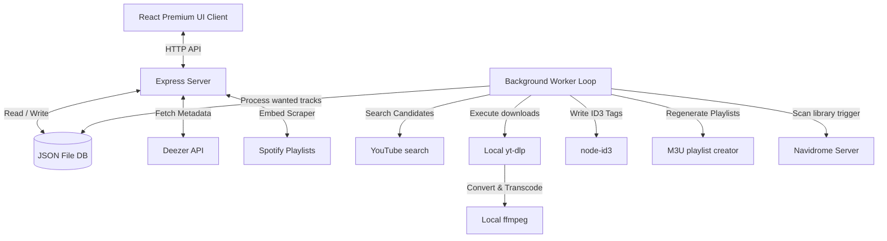

# Songarr 🎵

Songarr is a **track-first self-hosted music acquisition and automation platform** designed to bridge streaming discovery with local library ownership. It addresses the "album-centric" limitation of Lidarr by allowing you to search, request, download, tag, and organize individual tracks.

With Songarr, you can discover a song (via Shazam, streaming, etc.), search it on your phone/browser, and add it directly to your homelab collection (e.g., served via Navidrome, Jellyfin, or Plex) with a single click.

---

## Key Features

- 🔍 **Track-First Search**: Search the global Deezer catalog (millions of tracks with high-res cover art) and request single tracks with one click.
- 🧠 **Intelligent matching scoring**: Evaluates YouTube search results based on title relevance, artist matching, Topic/official status, and duration differences to find studio-quality audio rather than live performances or bootleg covers.
- ⚡ **Auto-download & post-processing**: Automatically fetches tracks using `yt-dlp`, converts them to high-quality audio (`mp3` or `m4a`) using static `ffmpeg` builds, tags them with metadata (album art, title, artist, track number, year) using `node-id3`, and moves them to organized library folders: `music/{Artist}/{Album}/{Track} - {Title}.mp3`.
- 📁 **Navidrome M3U Sync**: Organizes local playlists inside Songarr and compiles Navidrome-compatible `.m3u` files in your library directory.
- 📡 **Navidrome Auto-Scan**: Webhook-based trigger to instruct your Navidrome server to scan the library folder immediately when new tracks are downloaded.
- 🔗 **Spotify Sync / Plain Text Importer**:
  - Paste any public Spotify playlist URL: Songarr scrapes the playlist details and schedules batch matches.
  - Paste lists of text (e.g. `Artist - Song`) to batch-request multiple items at once.
- 🛠️ **Fully Self-Contained**: Automatically downloads local static builds of `yt-dlp` and `ffmpeg` for your system architecture, running without global system package installations or root privileges.

---

## Installation & Setup

### Prerequisites

- [Node.js](https://nodejs.org/) (v18.0.0 or higher)
- [Python 3](https://www.python.org/) (required by `yt-dlp` to run download scripts)
- System tools `curl` and `tar` (for binary setup)

### Step 1: Initialize Binaries

Run the setup script to download and configure local static binaries for `yt-dlp` and `ffmpeg` / `ffprobe`:

```bash
chmod +x setup-binaries.sh
./setup-binaries.sh
```

### Step 2: Install Node Dependencies

```bash
npm install
```

### Step 3: Start Songarr

To launch both the API backend and the React Vite client in development mode with hot-reloading:

```bash
npm run dev
```

Your browser will open to `http://localhost:5173`. The backend listens on `http://localhost:3001` and handles background worker cycles.

---

## Production Deployment

### Option 1: Native Node Run
Build the frontend and run the production server:

```bash
npm run build
npm start
```
The application will be served fully on `http://localhost:3001`.

### Option 2: PM2 (Process Manager)
Run in the background using PM2:

```bash
pm2 start server/index.js --name songarr
```

---

## Database & Storage Paths

All files are structured locally inside the workspace:
- **Database**: `./data/db.json` (Atomic JSON-file store. No external DB servers needed).
- **Music Library**: `./music/` (Default path. Can be changed to `/mnt/music` or `/media/music` in Settings UI).
- **Playlists**: `./music/Playlists/` (M3U files).

---

## System Architecture



---

## Git & GitHub Integration

This repository has been initialized with git. To publish to your GitHub:

1. Create a new, blank repository on your GitHub account.
2. Link your local project directory and push:

```bash
git remote add origin <your-github-repo-url>
git branch -M main
git push -u origin main
```
