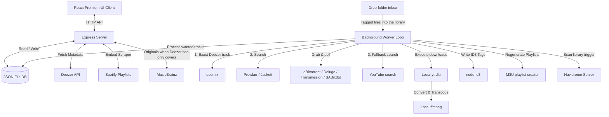

# Songarr 🎵

Songarr is a **track-first self-hosted music acquisition and automation platform** designed to bridge streaming discovery with local library ownership. It addresses the "album-centric" limitation of Lidarr by allowing you to search, request, download, tag, and organize individual tracks.

With Songarr, you can discover a song (via Shazam, streaming, etc.), search it on your phone/browser, and add it directly to your homelab collection (e.g., served via Navidrome, Jellyfin, or Plex) with a single click.

---

## Key Features

- 🔍 **Track-First Search**: Search the global Deezer catalog (millions of tracks with high-res cover art) and request single tracks with one click.
- 💿 **deemix source (optional)**: with a [deemix](https://github.com/bambanah/deemix) instance and a Deezer account, Songarr grabs the exact Deezer track first (FLAC on a paid plan, else the best MP3 the account allows) and falls back to torrents/YouTube only if that fails. It reuses the login saved in deemix, so the only setting is its URL. deemix downloads one queue item at a time; if it restarts with items still queued (it doesn't resume on its own), Songarr restarts the queue.
- 🧲 **Torrents and Usenet (optional)**: searches Prowlarr or Jackett and sends the grab to qBittorrent, Deluge, Transmission or SABnzbd. Songarr fetches the `.torrent` itself (clients behind a VPN often can't reach the indexer). A torrent with no progress for `stallTimeoutMinutes` (default 30) is dropped and the next candidate tried; after `maxTorrentAttempts` (default 3) the track goes to YouTube. Torrents keep seeding after import until an optional ratio/time limit, and the library copy is a hardlink, so seeding costs no extra space. Remote path mapping as in the *arrs.
- ♻️ **Skips what you already have**: a request whose file is already in its `Artist/Album (Year)/` folder is marked imported instead of downloaded again. With FLAC as the target, a lossy copy is upgraded through deemix, or else a torrent that claims FLAC (checked on arrival; a fake is dropped). The old file is removed only once the FLAC is in place.
- 📥 **Drop-folder inbox**: tagged files that land in a configured inbox folder (e.g. deemix's download dir) are moved into the library as `Artist/Album (Year)/NN - Title`, with their `.lrc`/cover. Untagged files and duplicates are left alone and listed in the UI. Never point it at a torrent download folder (refused).
- 🧠 **Intelligent matching scoring**: Evaluates YouTube search results based on title relevance, artist matching, Topic/official status, and duration differences to find studio-quality audio rather than live performances or bootleg covers.
- ⚡ **Auto-download & post-processing**: Automatically fetches tracks using `yt-dlp`, converts them to high-quality audio (`mp3` or `m4a`) using static `ffmpeg` builds, tags them with metadata (album art, title, artist, track number, year) using `node-id3`, and moves them to organized library folders: `music/{Artist}/{Album} ({Year})/{NN} - {Title}.{ext}`.
- 📁 **Navidrome M3U Sync**: Organizes local playlists inside Songarr and compiles Navidrome-compatible `.m3u` files in your library directory.
- 📡 **Navidrome Auto-Scan**: after each worker cycle Songarr asks Navidrome to rescan (Subsonic `startScan`), so new tracks show up without waiting for Navidrome's own schedule.
- 🔗 **Spotify Sync / Plain Text Importer**:
  - Paste any public Spotify playlist URL: Songarr creates a linked playlist (the same URL never makes a second one), picks the best Deezer match per track (scored on title, artist, duration and remix/live variants; MusicBrainz when Deezer only has covers) and queues it. Unmatched tracks are listed on the playlist, each with a Find button to pick the right track by hand (later syncs keep the pick). It re-syncs every `playlistSyncHours` (default 24, 0 = off; each playlist can set its own interval) or on "Sync now": new tracks are added, dropped ones leave the playlist and its M3U (files stay in the library), order follows Spotify. An "Add only" playlist keeps tracks Spotify drops. The Spotify embed lists at most 100 tracks, so longer playlists stop there. Playlist names are unique ("Name (2)"); the M3U follows the name.
  - Paste lists of text (e.g. `Artist - Song`) to batch-request multiple items at once.
- 🛠️ **No system packages needed**: the Docker image bundles `ffmpeg` and `yt-dlp`; for a native install, `setup-binaries.sh` downloads `yt-dlp` and a static x86-64 `ffmpeg` into `./bin`, no root needed.

---

## Installation & Setup

### Prerequisites

- [Node.js](https://nodejs.org/) (v18.0.0 or higher)
- [Python 3](https://www.python.org/) (required by `yt-dlp` to run download scripts)
- System tools `curl` and `tar` (for binary setup)

### Step 1: Initialize Binaries

Run the setup script to download and configure local static binaries for `yt-dlp` and `ffmpeg` / `ffprobe`:

```bash
chmod +x setup-binaries.sh
./setup-binaries.sh
```

### Step 2: Install Node Dependencies

```bash
npm install
```

### Step 3: Start Songarr

To launch both the API backend and the React Vite client in development mode with hot-reloading:

```bash
npm run dev
```

Your browser will open to `http://localhost:5173`. The backend listens on `http://localhost:3001` and handles background worker cycles.

---

## Production Deployment

### Option 1: Native Node Run
Build the frontend and run the production server:

```bash
npm run build
npm start
```
The application will be served fully on `http://localhost:3001`.

### Option 2: PM2 (Process Manager)
Run in the background using PM2:

```bash
pm2 start server/index.js --name songarr
```

---

### Option 3: Docker

Releases are published to GHCR (amd64 only for now):

```bash
docker run -d --name songarr -p 3001:3001 \
  -e PUID=1000 -e PGID=1000 -e TZ=America/Anchorage \
  -v /path/to/appdata/songarr:/config -v /path/to/music:/music \
  ghcr.io/jlesterak/songarr:latest
```

Or build it yourself with `docker build -t songarr .`. When using a torrent client or deemix, also mount their download folder, ideally at the same path they use (then no path mapping is needed). The UI shows the running version at the bottom of the sidebar.

The image bundles ffmpeg and yt-dlp (updated at each start; `-e YTDLP_AUTOUPDATE=false` to skip). A DockSTARTer template proposal is in `dockstarter/`. To check the bundled tools and the outside services from inside a running container: `docker exec songarr npm run check:live`.

---

## Database & Storage Paths

Defaults are relative to the working directory; each can be moved with an environment variable:

| What | Default | Override |
|---|---|---|
| Database (`db.json`, atomic JSON store) | `./data/` | `SONGARR_DATA_DIR` |
| Music library (default for the Library Path setting) | `./music/` | `SONGARR_MUSIC_DIR` |
| Download/convert scratch space | `<data>/temp/` | `SONGARR_TEMP_DIR` |
| yt-dlp / ffmpeg / ffprobe | `./bin/` if present, else `PATH` | `SONGARR_BIN_DIR` |

Playlists are written to `<library>/Playlists/` as M3U files.

**Security.** Set `SONGARR_USERNAME` and `SONGARR_PASSWORD` to require a login (HTTP Basic auth) for the UI and API; `/api/v1/health` stays open for the container healthcheck. Without them anyone who can reach the port can use Songarr. Stored secrets (indexer API key, client password, Navidrome token) are never sent back to the browser: the settings API returns `********` for them, and saving that mask keeps the stored value.

`SONGARR_MOCKS=1` mounts fake Prowlarr/Jackett/qBittorrent/Deluge/Transmission/SABnzbd endpoints at `/api/v1/mock` for development. Leave it unset in real installs.

---

## System Architecture



---

## Testing

```bash
npm test             # offline: matching, database, playlists, and the deemix and torrent paths against fakes
npm run check:live   # needs internet: yt-dlp/ffmpeg runnable, Deezer search, Spotify embed scraper
```

`npm test` never touches the network: it uses a throwaway data directory and stub yt-dlp/ffmpeg binaries that always fail.
Set `SONGARR_TEST_VERBOSE=1` to see server logs.
